<h1 align="center">Morphix</h1>

<p align="center"><b>Say it. See it. Print it.</b><br>
Turn a spoken idea, a photo or a drawing into a 3D model, check it, slice it, and print it on the printer you already own, from any browser on your network.</p>

<p align="center">
  <a href="https://devpost.com/software/morphix-kbzot2"></a>
  <a href="https://www.youtube.com/watch?v=HJM8_yL3bGg"></a>
  
  <a href="LICENSE"></a>
  
</p>

<p align="center">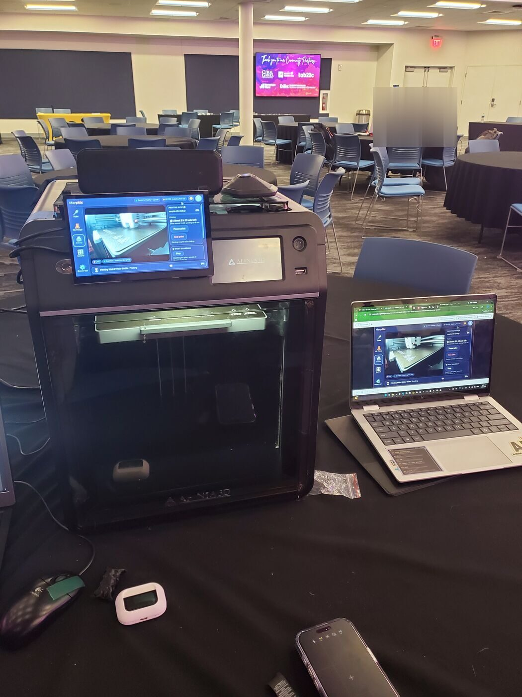</p>

> **🏆 1st Place Overall at SharkByte 2026** (and the MLH *Build Your Hackathon A-Team* prize). Read the story, see the
> photos and watch the pitch on **[Devpost](https://devpost.com/software/morphix-kbzot2)**.
> Morphix started as a weekend hackathon prototype: a Raspberry Pi 4, a touchscreen and an Afinia QD330. It is now being opened up so
> anyone can run it on any Linux machine with the printer they already have. It is still experimental software. Read
> [Safety](#safety) before you print.

---

## Contents

[Demo](#demo) · [What it does](#what-it-does) · [Screenshots](#screenshots) · [How it works](#how-it-works) · [Install](#install) ·
[First run](#first-run) · [Printers](#printers) · [Slicers](#slicers) · [AI features and keys](#ai-features-and-keys) ·
[Touchscreen kiosk](#touchscreen-kiosk) · [Safety](#safety) · [Security](#security) · [Development](#development) ·
[Project layout](#project-layout) · [The hackathon](#the-hackathon) · [Team](#team) · [License](#license)

## Demo

<table>
<tr>
<td width="50%" align="center">
<a href="https://www.youtube.com/watch?v=HJM8_yL3bGg">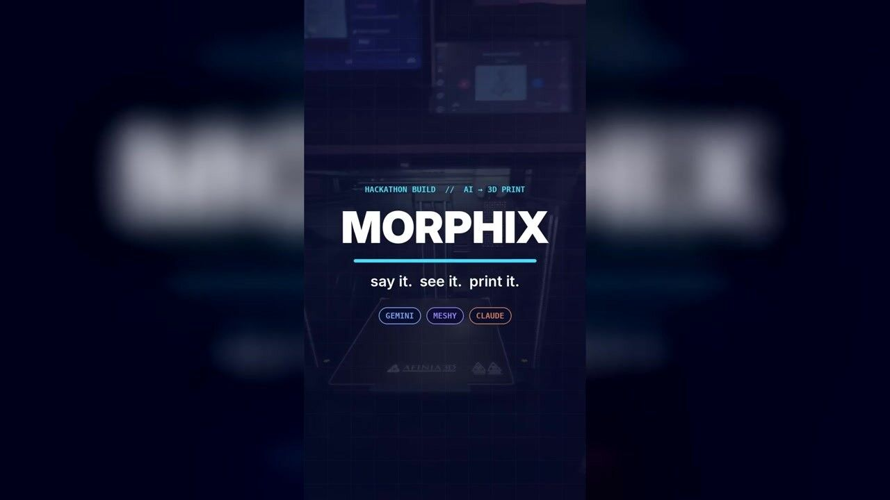</a><br>
<b>▶ The competition demo</b> (YouTube): the pitch and the live demo from SharkByte 2026.
</td>
<td width="50%" align="center">
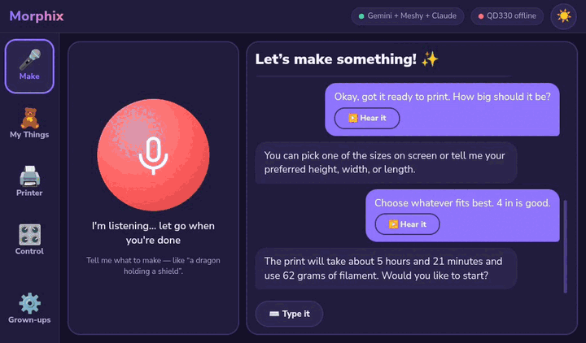<br>
<b>The touchscreen flow</b>: "make me a water bottle with a screw-on cap", the engine choice, Claude designing it, the 3D preview and the AI's print settings.
</td>
</tr>
</table>

The full touchscreen replay of the live demo is in the repo: [`docs/media/morphix-touchscreen-replay.mp4`](docs/media/morphix-touchscreen-replay.mp4)
(4:42, 1024×600; the first two minutes are the idle start screen). It was recorded on a second copy of Morphix with no printer attached,
which is why it says "QD330 offline" and "Can't print yet".

## What it does

| | |
|---|---|
| 🎤 **Talk to it** | Hold the button and say what you want. Gemini Live answers out loud, asks how big it should be and proposes what to make. Nothing that costs money or moves the printer happens until you tap **Confirm**. |
| 🧠 **Three ways to make a model** | **Meshy** for toys, figures and things to look at; **Claude + OpenSCAD** for exact-size parts that must fit or work (screw caps, brackets, phone cases); **Smart Model Search** for proven free designs on Printables, Thingiverse, MakerWorld and GitHub, with licence and "has it been printed?" checks. Morphix recommends one and you choose. |
| 📷 **From a photo or drawing** | Photo / drawing / scan → printable model (see [photo-to-3D](docs/PHOTO3D.md)). |
| 🧊 **See it first** | A 3D viewer with the real size in mm and a "fits the printer?" check. Pick a height, width or length and it rescales. |
| 🛠️ **Prepare** | Repair the mesh, lay it flat, check the build volume, then slice with PrusaSlicer, OrcaSlicer or Bambu Studio. An AI advisor picks layer height, infill, supports and brim, and says why. Or choose them yourself. |
| 🖨️ **Print** | Send the file to the printer over its own LAN or USB protocol, then follow progress, layers, temperatures and time left. Pause / resume / cancel. |
| 👀 **Print Guardian** | Camera monitoring with OpenCV (and optional Gemini vision) that spots spaghetti and detached prints, warns out loud, and asks "stop or keep printing?". |
| 🩹 **Self-healing** | Reconnects services, clears stale locks and retries safe steps on its own. It never prints, heats, cancels a real print or spends credits by itself ([details](docs/SELF-HEAL.md)). |
| 🌐 **Any browser** | One headless server. Use it from a phone, tablet or laptop on your network, or on a touchscreen next to the printer. |

## Screenshots

<table>
<tr>
<td width="50%"><br><sub><b>Make</b>: a voice conversation about size and print time.</sub></td>
<td width="50%">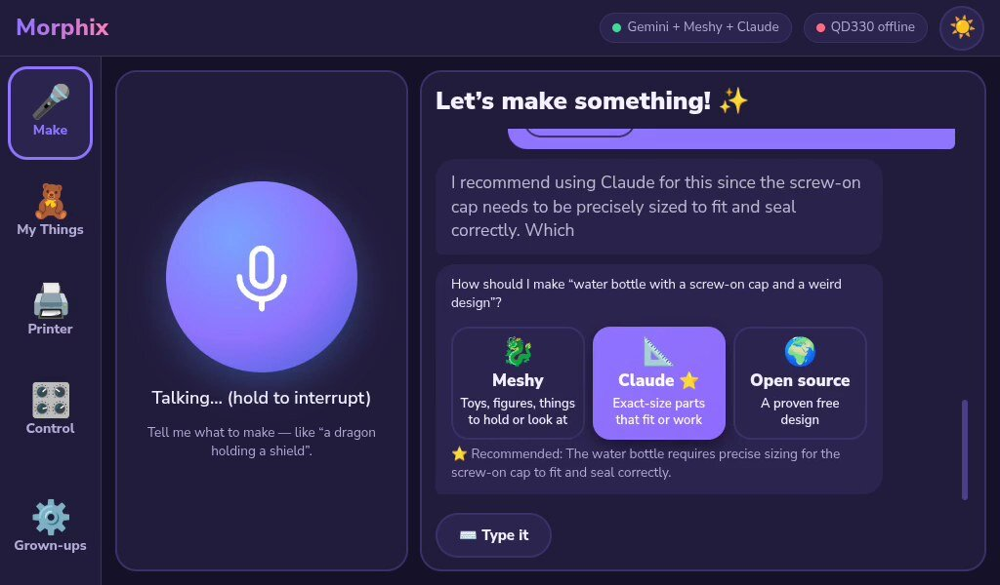<br><sub><b>Engine choice</b>: Morphix recommends Claude for a part that must fit.</sub></td>
</tr>
<tr>
<td>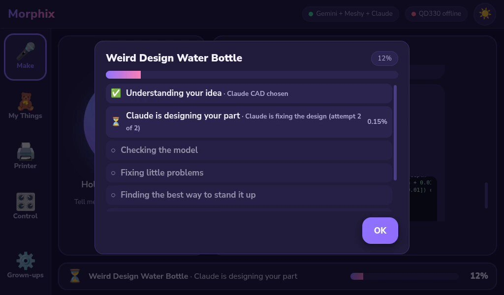<br><sub><b>Claude designing</b>: OpenSCAD, rendered, checked and repaired, step by step.</sub></td>
<td>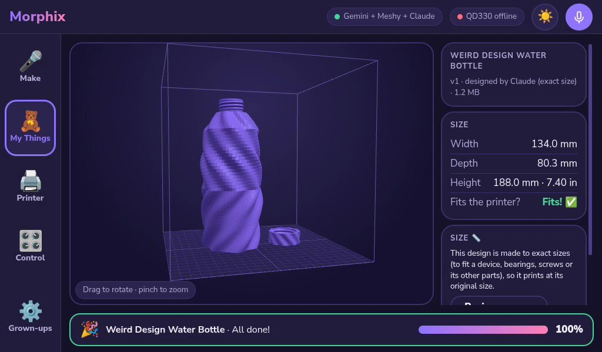<br><sub><b>Viewer</b>: exact size in mm and "fits the printer?".</sub></td>
</tr>
<tr>
<td>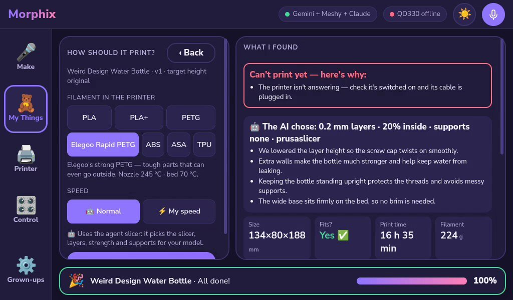<br><sub><b>Prepare</b>: the AI picks the settings and explains them; filament, speed, time and grams.</sub></td>
<td>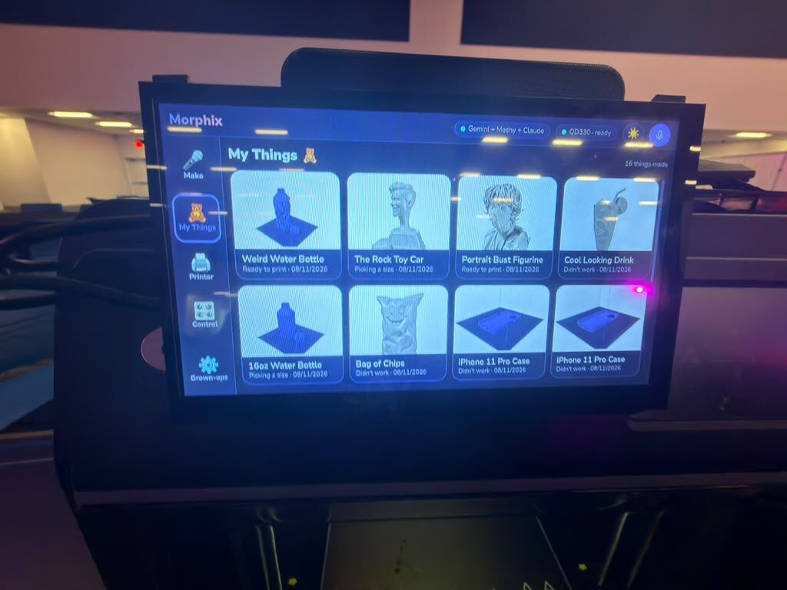<br><sub><b>My Things</b>: every model you made, ready to print again.</sub></td>
</tr>
<tr>
<td>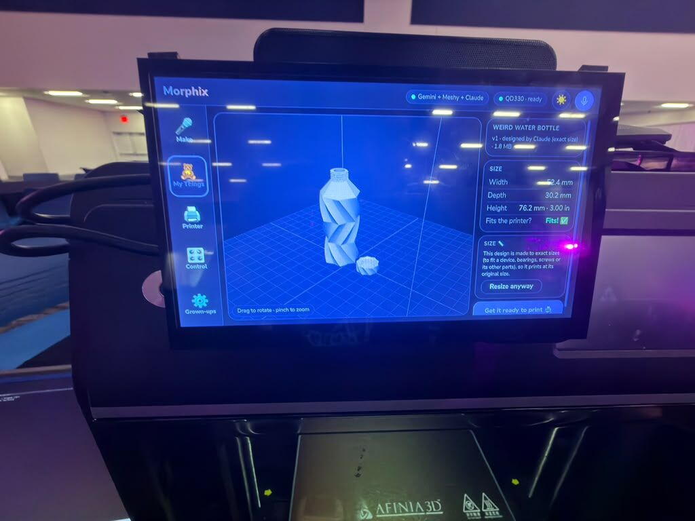<br><sub>The viewer on the touchscreen at the hackathon.</sub></td>
<td>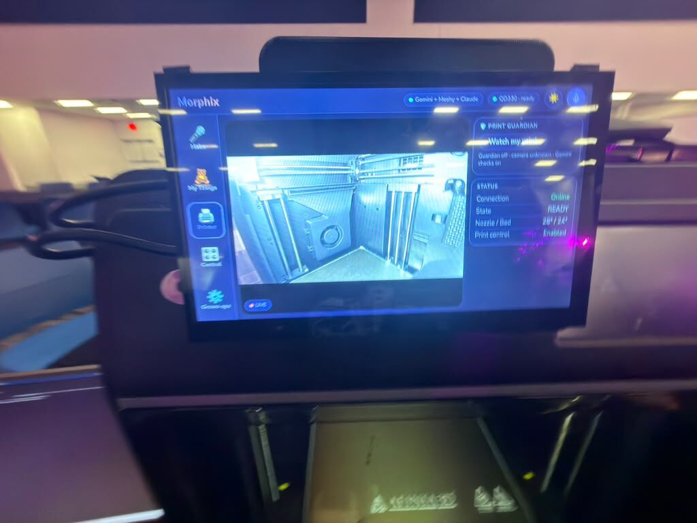<br><sub><b>Printer</b>: live camera, status and Print Guardian.</sub></td>
</tr>
</table>

### The hackathon build

<table>
<tr>
<td width="33%">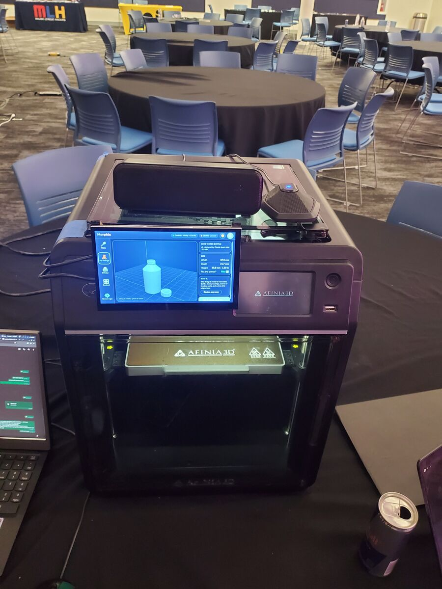<br><sub>Front: the touchscreen on the QD330.</sub></td>
<td width="33%">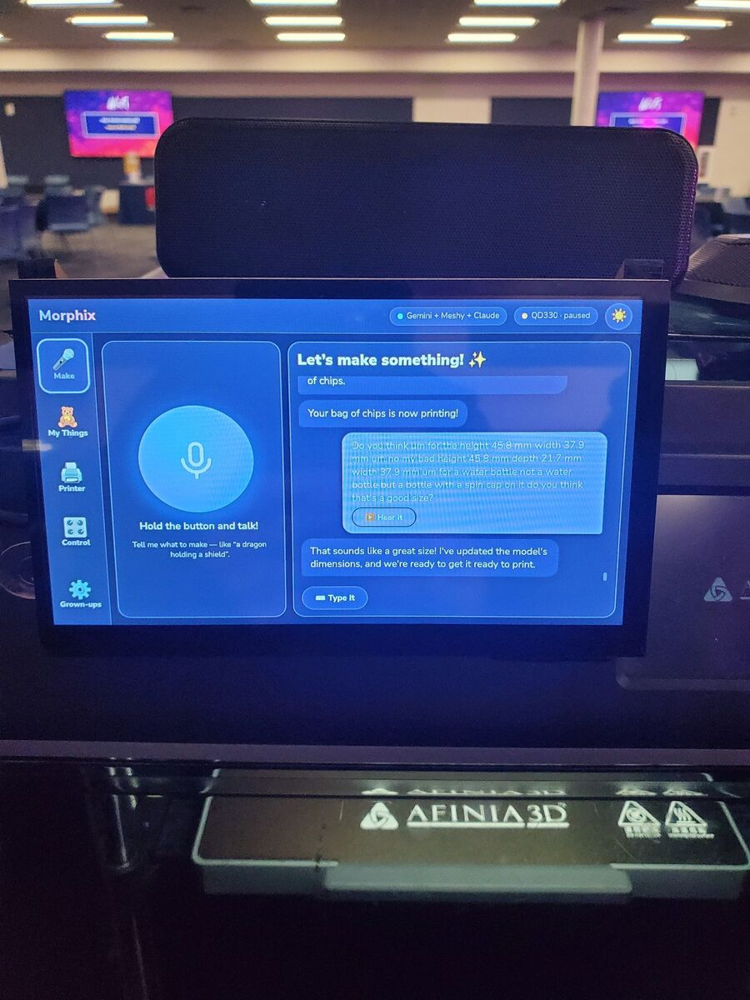<br><sub>The Make screen.</sub></td>
<td width="33%">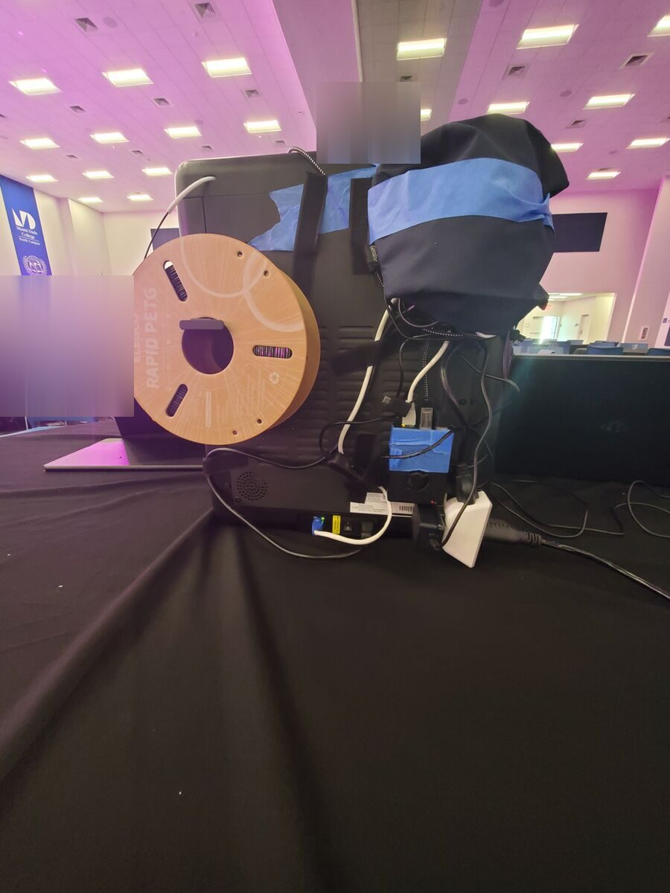<br><sub>Back: the Pi and the filament.</sub></td>
</tr>
<tr>
<td>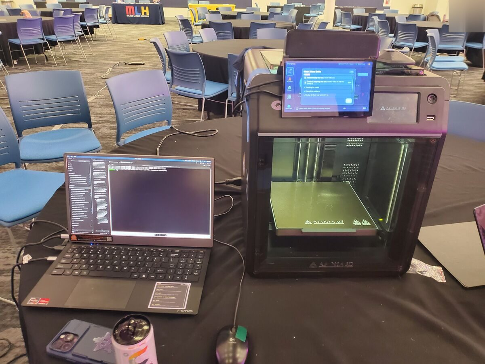<br><sub>The demo table.</sub></td>
<td>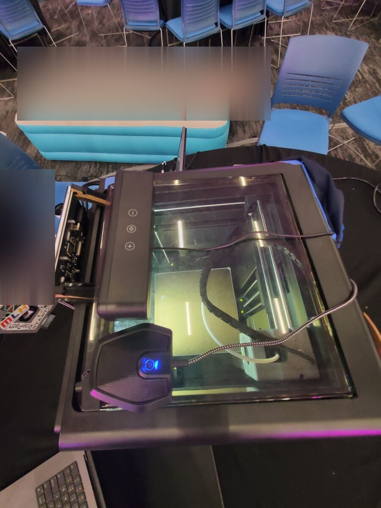<br><sub>Top view.</sub></td>
<td>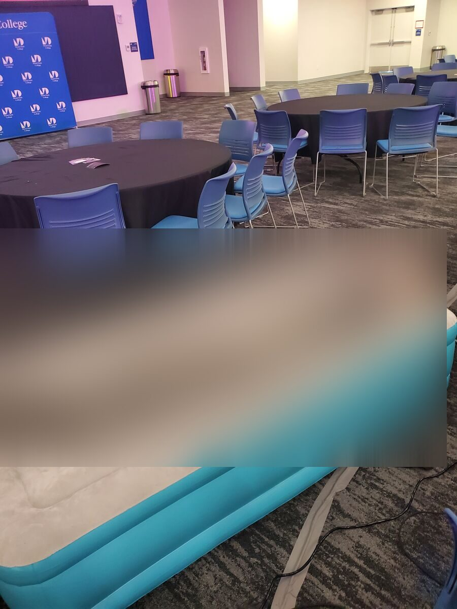<br><sub>Sleep: optional, apparently.</sub></td>
</tr>
</table>

More photos are on [Devpost](https://devpost.com/software/morphix-kbzot2).

## How it works

```mermaid
flowchart LR
  subgraph clients["Any device on your network"]
    B["Browser<br/>(phone · tablet · laptop)"]
    K["Touchscreen kiosk<br/>(optional, Electron)"]
  end
  subgraph server["Morphix server (one Node.js process, headless)"]
    R["Router<br/>auth · CSRF · rate limit"]
    RPC["RPC: POST /api/rpc/*<br/>Events: GET /api/events (SSE)"]
    C["Core<br/>projects · jobs · voice · guardian · self-heal"]
    UI["Web UI (React)"]
  end
  subgraph ai["Cloud AI (your own keys, optional)"]
    G["Gemini Live"]
    M["Meshy"]
    CL["Claude + OpenSCAD"]
  end
  S["Slicer<br/>PrusaSlicer · OrcaSlicer · Bambu Studio"]
  P["Your printer<br/>LAN / USB driver"]
  B & K -->|HTTP(S)| R --> RPC --> C
  R --> UI
  C --> G & M & CL
  C --> S
  C -->|upload · start · status| P
```

- **One server, no screen needed.** `apps/server` is plain `node:http` (no framework). Every app call is `POST /api/rpc/<channel>`,
  and live updates (printer status, generation progress, voice) stream over Server-Sent Events. The same core also powers the optional Electron kiosk.
- **Printers** are drivers behind one contract (`packages/printer/src/drivers/types.ts`): Moonraker/Klipper, OctoPrint, PrusaLink, Duet,
  Bambu LAN, Elegoo SDCP, Creality K1, FlashForge, Marlin over USB, Ultimaker and Snapmaker.
- **Slicers** are adapters behind one contract (`packages/slicing/src/adapters/types.ts`). Morphix finds the ones installed and uses the one that can make your printer's file.
- **A catalog** of printer models (bed size, nozzle, max temperatures, file format, start G-code) drives slicing, temperature limits and the setup page (`packages/catalog`).
- **Your data stays local** in one data directory: models, database, logs, keys (mode 0600). See [architecture](docs/ARCHITECTURE.md) and [the open-platform plan](docs/GOAL.md).

## Install

Morphix runs on any Linux machine next to your printer: a Raspberry Pi 4/5, an old PC, a mini PC or a VM (Debian, Ubuntu, Raspberry Pi OS,
Fedora, Arch; x86_64, arm64, armv7).

**One line** (installs Node.js 22 if needed, builds, and sets up a systemd service):

```bash
curl -fsSL https://raw.githubusercontent.com/JI-s-BS/morphix/main/scripts/install/install.sh | bash
```

Prefer to read it first? Download `scripts/install/install.sh`, read it, then run it. Docker, user installs, Raspberry Pi notes,
updates, rollback, backup and uninstall are covered in **[docs/INSTALL.md](docs/INSTALL.md)**.

When it finishes it prints the address, for example `http://192.168.1.20:8080`. Open it from any device on your network.

**Everyday commands:**

| Command | |
|---|---|
| `morphix status` | Service, version, health and the address to open |
| `morphix logs -f` | Follow the server log |
| `morphix update` / `morphix rollback` | Update (tested, health-checked, rolls back on failure) / go back |
| `morphix doctor` | Check everything; each problem comes with a fix |
| `morphix backup` / `morphix restore FILE` | Save / restore your data |
| `morphix reset-admin` | Set a new admin password |

**From source** (for development, or if you'd rather not use the installer):

```bash
git clone https://github.com/JI-s-BS/morphix.git && cd morphix
npm ci
npm run build:server && npm run build:renderer
npm run start:server          # http://<this-machine>:8080
```

| Environment | Default | |
|---|---|---|
| `MORPHIX_DATA_DIR` | `~/.local/share/morphix` | Models, database, logs, keys |
| `MORPHIX_PORT` | `8080` | |
| `MORPHIX_BIND` | `0.0.0.0` | Use `127.0.0.1` to keep it on this machine |

`GET /api/health` answers `{ ok, version, uptimeS }` for monitoring. HTTPS with a self-signed certificate (made on the machine with `openssl`) is used when the server setting `https` is on.

## First run

The first visit opens the **setup page**:

1. **Admin password.** Morphix asks you to sign in from then on; it never uses a cloud account.
2. **API keys** for the AI features you want (all optional, see below). They are stored on the server and the page only ever shows "set / not set".
3. **Your printer.** Pick the brand and model, enter its address (some printers can be found on the network automatically), then **Test connection**.
4. **Slicer.** Morphix shows which slicers it found, and how to install one if none is.

Then: **Make** → talk or type → choose how to make it → check the size → **Get it ready to print** → **Print** → **Confirm**.

## Printers

Morphix talks to your printer directly over your network or USB. It never needs the maker's cloud. The catalog has **105 models
from 20 brands**. Each brand has a setup guide in **[docs/printers](docs/printers/README.md)** covering how to switch on LAN mode or the API,
and where to find the access code.

| Brand | Connection |
|---|---|
| Afinia QD330 | FlashForge TCP (**hardware-tested**) |
| Bambu Lab (X1, P1, A1, H2) | Bambu LAN mode (MQTT + FTPS) |
| Prusa (MK4/S, MK3.9, CORE One, MINI+, XL) | PrusaLink |
| Creality (K1, K2, Hi, Ender-3 V3) | Creality K1 API, or Moonraker if rooted |
| Elegoo Centauri Carbon / Neptune 4 | SDCP / Moonraker |
| Voron, RatRig, Sovol, Qidi, Anycubic (Rinkhals) | Moonraker (Klipper) |
| Any OctoPrint or Duet/RepRapFirmware printer | OctoPrint / Duet HTTP |
| Older Marlin printers (Ender-3, MK3S+, Neptune 3 …) | USB serial |
| Ultimaker, Snapmaker, FlashForge Adventurer | Their LAN APIs |

> **Honest status:** only the **Afinia QD330** has been run end to end on real hardware. Every other driver was written from the
> maker's (or the community's) protocol documents and tested against fakes. Each is marked `verified: "protocol"`, and its guide says so.
> If you try one, please open an issue with what worked and what didn't.

## Slicers

Morphix uses the slicer you already have, or tells you how to install one: **PrusaSlicer**, **OrcaSlicer** or **Bambu Studio**
(packages, Flatpak or AppImage). Bambu printers need OrcaSlicer or Bambu Studio for `.gcode.3mf`; the QD330 gets its `.gx` format.
Profiles come from the printer catalog, so the bed size, origin, nozzle and start G-code match your printer.

## AI features and keys

Everything AI is optional and uses **your own** accounts (usage may cost money). Without keys you can still import models, slice and print.

| Key | Enables |
|---|---|
| `GEMINI_API_KEY` | The voice assistant (Gemini Live), the AI slicing advisor, Smart Model Search, Guardian vision |
| `MESHY_API_KEY` | Text/image → 3D models (toys, figures). A daily limit protects your credits. |
| `ANTHROPIC_API_KEY` | Claude + OpenSCAD for exact-size parts (needs `openscad` installed) |
| `THINGIVERSE_TOKEN` | Downloading Thingiverse designs straight into Morphix |

Add them on the setup page (**Settings → API keys**). Every paid action, such as a Meshy generation or a refine, waits for you to confirm it.

## Touchscreen kiosk

A screen next to the printer is optional. Either point any kiosk browser at the server
(`chromium --kiosk http://localhost:8080`), or use the Electron shell:

```bash
npm run build                                       # server, web UI and Electron
MORPHIX_SERVER_URL=http://localhost:8080 npm start  # just show the running server
npm start                                           # or run everything in-process (the original Pi setup)
```

The original hackathon hardware was a Raspberry Pi 4 with a 1024×600 touchscreen on an Afinia QD330 ([docs/INSTALL.md](docs/INSTALL.md#touchscreen-kiosk)).

## Safety

- **Nothing prints, heats or moves without you.** A print is proposed, you see the file, size, time and filament, and only **Confirm**
  sends it. Morphix re-checks that the printer is idle right before sending.
- **Temperatures are clamped** to your printer model's limits from the catalog. Unknown models get no temperature controls.
- **The AI never confirms for you.** Voice can propose; a tap (or a clearly spoken "yes" to that exact proposal) confirms it.
- **Print Guardian is a helper, not a babysitter.** Stay near the printer, especially on a first print with a new printer or filament.
- Check generated models and slicer output before printing. Hardware-validation notes for the QD330 are in [PHASE5.md](docs/PHASE5.md).

## Security

- **Built for a home or school network.** Don't forward it to the internet. For remote access, use a VPN such as Tailscale or WireGuard.
- Sign-in is required for everything except the page itself and `/api/health`. Every request that changes something needs a per-session CSRF token and
  must come from Morphix's own page. Strict security headers (CSP, `X-Frame-Options: DENY`, `nosniff`), request size limits and a per-IP rate limit apply.
- Keys and passwords live only in the data directory (mode 0600). They never go into logs, URLs or the browser.
- Found a problem? Please report it privately to the maintainers rather than in a public issue.

## Development

```bash
npm ci
npm test              # Vitest
npm run typecheck     # TypeScript
npm run build:server  # apps/server/dist/server.cjs
npm run dev:renderer  # Vite dev server for the UI; proxies /api to MORPHIX_DEV_SERVER (default :8080)
VITE_MORPHIX_MOCK=1 npm run dev:renderer   # UI preview with an in-browser mock, no server
```

Useful docs: [GOAL.md](docs/GOAL.md) (the open-platform plan and contracts), [ARCHITECTURE.md](docs/ARCHITECTURE.md), [CAD.md](docs/CAD.md),
[PHOTO3D.md](docs/PHOTO3D.md), [JOBS.md](docs/JOBS.md), [ERRORS.md](docs/ERRORS.md), [SELF-HEAL.md](docs/SELF-HEAL.md), and the vision worker in
[services/vision](services/vision/README.md).

**Adding a printer** means one driver file implementing `PrinterDriver`, a catalog entry and a setup guide, plus tests against a fake printer.
**Adding a slicer** means one `SlicerAdapter`. See [CONTRIBUTING.md](CONTRIBUTING.md).

## Project layout

```text
apps/server/            Headless server: router, RPC + SSE, static UI, core wiring
apps/desktop/src/       React web UI (also shown by the kiosk)
apps/desktop/electron/  App modules (printing, voice, generation, photo, guardian voice …) + optional kiosk shell
packages/printer/       Printer drivers (http / lan / serial families) and the QD330 controller
packages/slicing/       Mesh repair, placement, slicer adapters, AI slicing advisor
packages/catalog/       Printer models and their limits
packages/config/        Settings, keys, sign-in and the setup page's API
packages/…              Gemini, Meshy, CAD (Claude + OpenSCAD), model search, guardian, jobs, storage, database …
services/vision/        Python/OpenCV camera worker for Print Guardian
scripts/install/        Installer and the `morphix` command
docs/                   Guides; docs/printers has one per brand
```

## The hackathon

Morphix was built in one weekend at **SharkByte 2026**, where it won **1st Place Overall** and the
**MLH "Build Your Hackathon A-Team"** prize. It started with a Formula 1 fan who wanted to print a working F1 car and
couldn't find a model. Why can't we just describe what we want and have AI design it? The full story,
including the energy-drink findings, is on **[Devpost](https://devpost.com/software/morphix-kbzot2)**.

The hackathon build ran on a Raspberry Pi 4 with a touchscreen on an Afinia QD330 and used Gemini Live, Meshy, Claude, PrusaSlicer, Electron
and React, plus sponsor tools (Auth0, Vercel, Tiger Data, Swarms AI, Vultr) for the phone app and cloud extras. The open-source version
keeps everything local: the phone app became the built-in website, and the sponsor-only integrations were removed.

**What's next:** hardware-test more printers with the community, real-time Guardian improvements, a better phone layout, and getting
Morphix into schools and makerspaces. And yes, still that working Formula 1 car.

## Team

Built at SharkByte 2026 by **Milana Lamdan**, **Isaiah**, **Nicholas Fernandez** and **Jonathan Hack**.

## License

[MIT](LICENSE). Third-party services, slicers and imported models keep their own licences and terms. Smart Model Search shows each
design's licence, so respect it.
